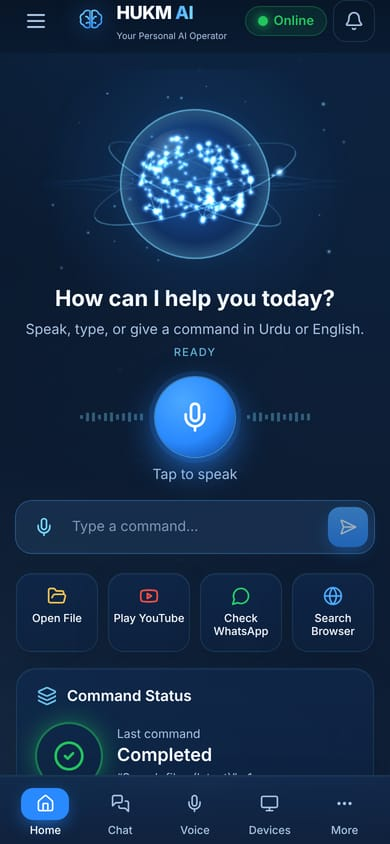
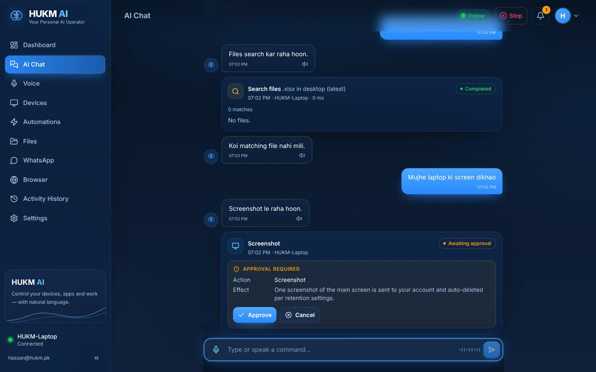

# HUKM AI — Your Personal AI Operator
**Just Speak. It's Done.**

## Current development release — v1.7.0 (21 Nov 2026)

**New in v1.7.0:** Owner-clicked live Gemini chat/planner diagnostics on Settings > AI engine, corrected live controller/backend version comparison, and an **experimental one-file HUKM Setup EXE** (CI-built, unsigned) alongside the legacy ZIP. The one-file installer requires a real Windows acceptance check and a trusted direct website download channel before broad release. **Automatic website-managed updates are not implemented yet.**

Read [the Gemini + one-time installer audit](docs/v170-gemini-and-one-time-setup-audit.md) for verified vs pending items.

> **Automated CI is not a real-laptop acceptance test.** This repository contains the verified-at-build-time implementation, not a guarantee that WhatsApp, third-party websites, Gmail or Calendar work end to end on the owner's actual Windows machine.

| System | Current scope |
|---|---|
| Core Gemini conversation, project memory and reviewed plans | Code implemented, relay tests automated |
| Windows controller: mouse/keyboard, browser, UIA, screenshots and file handling | Supervised allowlisted actions, EXE build + simulation; **real screen test deferred** |
| Personal WhatsApp Desktop | App-only best-effort select/read/draft/attachments and separately reviewed Send; **not real-account verified** |
| Voice | Web Speech API + optional voice output; real Roman Urdu recognition accuracy unbenchmarked |
| Gmail/Outlook | Inbox-opening and compose links **only**; no verified read, send or saved draft |
| Google/Outlook Calendar | Reviewed event draft/save UI; no guaranteed provider-side event ID/invitations |
| Premium Projects dashboard | Isolated messages, notes, instructions, per-project task history and device selection |
| Final release | GitHub Actions validates web/relay, simulated Windows and ZIP packaging. **Live Render and real-PC testing outstanding** |

**Run the app on the HUKM Node relay origin.** GitHub Pages is static hosting: a successful Pages build is **not** evidence that `/api`, authenticated sessions, WebSockets or the laptop controller work. To check an authorized relay deployment without credentials:

```bash
npm run check:relay -- --url https://YOUR-RELAY-ORIGIN --expected-version 1.7.0
```

This read-only preflight checks public health/auth routes and that owner-only runtime status returns 401 to anonymous users. It intentionally cannot verify Gemini response quality, connected laptop or external actions. For details see [Phase 6 release and deployment audit](docs/phase6-v167-release-audit.md). The historical Version 1 feature table below describes the original architecture and should not be used as current deployment evidence.


HUKM AI lets you control **your own Windows laptop** from a phone or desktop browser, by text or voice, in **Urdu, Roman Urdu or English**.

```
 Phone / laptop browser ──HTTPS + WebSocket──►  HUKM Relay (Node, SQLite)  ◄──outbound WSS──  Windows Controller (Python)
   React PWA (this UI)                           auth · pairing · queue ·                        allowlisted actions on
   voice in/out, brain orb                       approvals · audit · history                     the laptop, visible window
```


| Mobile | Approval flow |
|---|---|
|  |  |

## Original Version 1 feature notes (historical)

| Area | Status |
|---|---|
| Web app (desktop + mobile, PWA-installable, dark/light) — all 10 sections | ✅ built |
| Account (owner setup code, login, sessions, password change) | ✅ built + tested |
| Device pairing (expiring single-use code), online/offline, heartbeat, reconnect, unpair | ✅ built + tested |
| Command queue, approvals, cancel, timeouts, duplicate protection, emergency stop, audit log | ✅ built + tested |
| Deterministic Urdu / Roman Urdu / English command engine (no paid AI) | ✅ built + 60 tests |
| Open folders, launch allowlisted apps, file search/open/reveal, web search, open URLs, YouTube search/play-top-result, device status, list open apps, active window, lock (approval), screenshot (approval) | ✅ implemented; **Windows behaviour needs your manual test** (see docs/testing.md) |
| WhatsApp: open, unread **count** from window title, draft via official click-to-chat link (you press Send) | ✅ implemented (partial by design) |
| WhatsApp: read messages, list chats, auto-send | ⛔ not connected (needs an authorised integration) |
| Voice input (browser speech recognition, ur-PK etc.) and spoken replies (system voices) | ✅ where the browser supports it; accuracy not benchmarked |
| Saved automations (manual run) | ✅ · Scheduled runs: ⛔ not built |
| ChatGPT-subscription AI adapter | ⛔ not built — researched, see docs/integration-status.md |

Full checklist with evidence: **[docs/integration-status.md](docs/integration-status.md)**.

## Quick start (local)

Requirements: **Node.js 22.13+**, **Python 3.10+** (only to run/build the controller from source).

```bash
npm install
npm run build          # builds the web app and the relay
npm start              # http://localhost:8787 — the console prints a one-time SETUP CODE
```

1. Open http://localhost:8787, enter the setup code, create your owner account.
2. **Devices → Pair new device → Generate pairing code.**
3. On the Windows laptop: `hukm-controller.exe` (or `apps\windows-controller\run-controller.bat`), enter the relay URL and the code.
4. Type **“Downloads folder kholo”** — the folder opens on the laptop and the result appears in History.

To use it from your phone (and to use the microphone, which browsers only allow on HTTPS) put the relay behind HTTPS — the free Cloudflare quick tunnel works: `scripts\start-tunnel.bat`. Step-by-step: **[docs/setup-guide.md](docs/setup-guide.md)**.

## Development

```bash
npm run dev            # relay (auto-reload) on :8787 + Vite on :5173 (proxying /api and /ws)
npm test               # 85 TypeScript tests: parser + relay integration (fake device)
npm run test:controller   # 20 Python tests incl. real relay ↔ controller end-to-end
npm run typecheck
```

## Repository layout

```
apps/web                 React + TypeScript + Vite + Tailwind PWA
apps/relay               Node + TypeScript relay: HTTP API, WebSockets, SQLite (node:sqlite)
apps/windows-controller  Python controller (+ PyInstaller packaging)
packages/command-protocol  shared parser, action allowlist/validation, localized messages, AIProvider interface
packages/shared-types    shared TypeScript types / WebSocket protocol
database/migrations      SQL schema (applied automatically)
database/security        authorization model
docs/                    architecture, setup, controller, security, testing, roadmap, integration status
tests/e2e                Playwright browser journey
```

## Docs
- [Architecture](docs/architecture.md) · [Setup guide](docs/setup-guide.md) · [Controller guide](docs/controller-guide.md)
- [Security](docs/security.md) · [Testing](docs/testing.md) · [Command reference](docs/command-reference.md)
- [Integration status & feature checklist](docs/integration-status.md) · [Roadmap](docs/roadmap.md)
