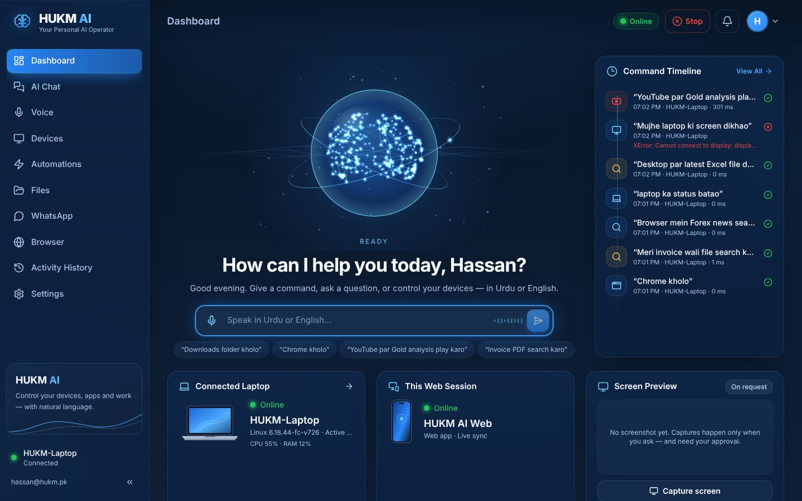

# HUKM AI — Your Personal AI Operator
**Just Speak. It's Done.**

## Current source candidate — v1.9.8 (owner acceptance required)

**v1.9.8:** Fix real owner-reported Roman Urdu spelling variants `Google calande kro` / `Google calnder open kro`, which previously opened a misleading Google Search result. Standalone commands now target Google Calendar; `meeting link ready krdo` starts a reviewed Calendar meeting-draft dialogue and asks for missing date/title/duration/profile. It does not claim a saved meeting or actual Google Meet link until independently confirmed. Real WhatsApp unread OCR still needs device acceptance for 2/4 partial results.


The tested source includes the newer Personal WhatsApp unread fixes, consented
Windows Live Screen preview (select physical Monitor 1–N), and supervised
observe → click → verify navigation with a mandatory stop on uncertain results.
These are **not proof of successful real user laptop execution**.

As checked on 23 Nov 2026, the connected Render relay's last confirmed live
deployment was still **v1.9.5**, while GitHub `main` had newer passing code.
See [v1.9.7 acceptance instructions](docs/hukm-v197-live-vision-acceptance.md)
and [Render deployment blocker](https://github.com/hassan-87psp/Hukam-Ai/issues/58).
Do **not** assume GitHub Actions success means the website, paired Windows
Controller, signed-in Chrome or Personal WhatsApp are updated.

Older development notes below remain historical and should not override the
current deployment or release status.

## Previous development release — v1.8.4 (21 Nov 2026)

**v1.8.4:** Fix opaque website update approval. The Devices page shows an inline command approval, running/download confirmation, final installer outcome and official manual recovery link. Controller logs every update stage without private data, brings owner confirmation to foreground, and gracefully exits the old Controller *after* reporting that the verified installer was launched to unlock its own EXE. The installed new version is not verified until the device reconnects. The existing v1.8.2/1.8.3 binary cannot receive fixes to its own updater without one successful installation; the official EXE provides a one-time recovery fallback if website updates are failing.

**v1.8.3:** Fix actual user-observed Windows Controller timeout: WhatsApp opened, then Unread scan ran 30 seconds and returned INTERRUPTED_UNVERIFIED. The unread sender action now runs **local visual OCR first**, avoiding a potentially unbounded WhatsApp WinUI accessibility tree traversal. Two on-device OCR passes have separate 22-second bounds and privacy-safe stage logs; the relay grants 90 seconds including cold startup, and cancellation is checked immediately before any mouse action and before reporting names. No automatic retries/sends, screenshot upload or guessed coordinates. Real signed-in WhatsApp acceptance still needs verification.

**v1.8.2:** For WhatsApp versions that hide the Unread chip from Windows UI Automation, the approved Desktop sender check tries in-memory **on-device Windows OCR** of only the left chat pane. A real mouse click is permitted only when OCR uniquely locates an Unread label between All and Favourites; it verifies a fresh screen and pairs visible chat titles with timestamps. It does not upload screenshots, click hardcoded coordinates, or pretend unread names are verified if the filter state is uncertain. Real Windows OCR and WhatsApp account acceptance are pending.

**v1.8.1:** Restores the actual minimized Personal WhatsApp Desktop main window, finds the Unread chip by accessible Name, AutomationId or HelpText, deduplicates nested UI controls, performs a local mouse click after explicit approval, and reads only visible chat sender names. "WhatsApp check karo" creates this multi-step workflow without needing Gemini. If WhatsApp exposes no trustworthy Unread control, HUKM reports an honest blocker instead of guessing mouse positions. The release requires automated tests and final real Windows acceptance.

**v1.8.0:** Owner-approved website-initiated update action for paired Controllers, restricted official GitHub Release + SHA-256, and mandatory local Windows approval (unsigned installer is NOT unattended). Exact named Personal WhatsApp Desktop reads and follow-up reply drafts without depending on Gemini. Initial v1.8.0 one-time Windows installation is still needed before future website updates. Live WhatsApp UIA acceptance remains pending.


**v1.8.0 fix:** Explicit Roman Urdu “note pad band kro” uses an owner-approved, exact Notepad window close request instead of incorrectly opening Notepad. Never terminates processes or auto-discards unsaved text. Live Windows confirmation and Render deployment are separate from CI validation.


**Previous version notes:** Owner-clicked Gemini diagnostics are in Settings > AI Engine. An **unsigned one-time Windows Setup EXE** is provided alongside the legacy ZIP. From Controller v1.8.0 onward, the website can request an *owner-approved* update from an exact official GitHub Release with SHA-256 verification and an additional Windows confirmation. Fully unattended/silent updates are deliberately unsupported.

Read [the Gemini + one-time installer audit](docs/v170-gemini-and-one-time-setup-audit.md) for verified vs pending items.

> **Automated CI is not a real-laptop acceptance test.** This repository contains the verified-at-build-time implementation, not a guarantee that WhatsApp, third-party websites, Gmail or Calendar work end to end on the owner's actual Windows machine.

| System | Current scope |
|---|---|
| Core Gemini conversation, project memory and reviewed plans | Code implemented, relay tests automated |
| Windows controller: mouse/keyboard, browser, UIA, screenshots and file handling | Supervised allowlisted actions, EXE build + simulation; **real screen test deferred** |
| Personal WhatsApp Desktop | App-only best-effort select/read/draft/attachments and separately reviewed Send; **not real-account verified** |
| Voice | Web Speech API + optional voice output; real Roman Urdu recognition accuracy unbenchmarked |
| Gmail/Outlook | Inbox-opening and compose links **only**; no verified read, send or saved draft |
| Google/Outlook Calendar | Reviewed event draft/save UI; no guaranteed provider-side event ID/invitations |
| Premium Projects dashboard | Isolated messages, notes, instructions, per-project task history and device selection |
| Final release | GitHub Actions validates web/relay, simulated Windows and ZIP packaging. **Live Render and real-PC testing outstanding** |

**Run the app on the HUKM Node relay origin.** GitHub Pages is static hosting: a successful Pages build is **not** evidence that `/api`, authenticated sessions, WebSockets or the laptop controller work. To check an authorized relay deployment without credentials:

```bash
npm run check:relay -- --url https://YOUR-RELAY-ORIGIN --expected-version 1.8.0
```

This read-only preflight checks public health/auth routes and that owner-only runtime status returns 401 to anonymous users. It intentionally cannot verify Gemini response quality, connected laptop or external actions. For details see [Phase 6 release and deployment audit](docs/phase6-v167-release-audit.md). The historical Version 1 feature table below describes the original architecture and should not be used as current deployment evidence.


HUKM AI lets you control **your own Windows laptop** from a phone or desktop browser, by text or voice, in **Urdu, Roman Urdu or English**.

```
 Phone / laptop browser ──HTTPS + WebSocket──►  HUKM Relay (Node, SQLite)  ◄──outbound WSS──  Windows Controller (Python)
   React PWA (this UI)                           auth · pairing · queue ·                        allowlisted actions on
   voice in/out, brain orb                       approvals · audit · history                     the laptop, visible window
```



| Mobile | Approval flow |
|---|---|
|  |  |

## Original Version 1 feature notes (historical)

| Area | Status |
|---|---|
| Web app (desktop + mobile, PWA-installable, dark/light) — all 10 sections | ✅ built |
| Account (owner setup code, login, sessions, password change) | ✅ built + tested |
| Device pairing (expiring single-use code), online/offline, heartbeat, reconnect, unpair | ✅ built + tested |
| Command queue, approvals, cancel, timeouts, duplicate protection, emergency stop, audit log | ✅ built + tested |
| Deterministic Urdu / Roman Urdu / English command engine (no paid AI) | ✅ built + 60 tests |
| Open folders, launch allowlisted apps, file search/open/reveal, web search, open URLs, YouTube search/play-top-result, device status, list open apps, active window, lock (approval), screenshot (approval) | ✅ implemented; **Windows behaviour needs your manual test** (see docs/testing.md) |
| WhatsApp: open, unread **count** from window title, draft via official click-to-chat link (you press Send) | ✅ implemented (partial by design) |
| WhatsApp: read messages, list chats, auto-send | ⛔ not connected (needs an authorised integration) |
| Voice input (browser speech recognition, ur-PK etc.) and spoken replies (system voices) | ✅ where the browser supports it; accuracy not benchmarked |
| Saved automations (manual run) | ✅ · Scheduled runs: ⛔ not built |
| ChatGPT-subscription AI adapter | ⛔ not built — researched, see docs/integration-status.md |

Full checklist with evidence: **[docs/integration-status.md](docs/integration-status.md)**.

## Quick start (local)

Requirements: **Node.js 22.13+**, **Python 3.10+** (only to run/build the controller from source).

```bash
npm install
npm run build          # builds the web app and the relay
npm start              # http://localhost:8787 — the console prints a one-time SETUP CODE
```

1. Open http://localhost:8787, enter the setup code, create your owner account.
2. **Devices → Pair new device → Generate pairing code.**
3. On the Windows laptop: `hukm-controller.exe` (or `apps\windows-controller\run-controller.bat`), enter the relay URL and the code.
4. Type **“Downloads folder kholo”** — the folder opens on the laptop and the result appears in History.

To use it from your phone (and to use the microphone, which browsers only allow on HTTPS) put the relay behind HTTPS — the free Cloudflare quick tunnel works: `scripts\start-tunnel.bat`. Step-by-step: **[docs/setup-guide.md](docs/setup-guide.md)**.

## Development

```bash
npm run dev            # relay (auto-reload) on :8787 + Vite on :5173 (proxying /api and /ws)
npm test               # 85 TypeScript tests: parser + relay integration (fake device)
npm run test:controller   # 20 Python tests incl. real relay ↔ controller end-to-end
npm run typecheck
```

## Repository layout

```
apps/web                 React + TypeScript + Vite + Tailwind PWA
apps/relay               Node + TypeScript relay: HTTP API, WebSockets, SQLite (node:sqlite)
apps/windows-controller  Python controller (+ PyInstaller packaging)
packages/command-protocol  shared parser, action allowlist/validation, localized messages, AIProvider interface
packages/shared-types    shared TypeScript types / WebSocket protocol
database/migrations      SQL schema (applied automatically)
database/security        authorization model
docs/                    architecture, setup, controller, security, testing, roadmap, integration status
tests/e2e                Playwright browser journey
```

## Docs
- [Architecture](docs/architecture.md) · [Setup guide](docs/setup-guide.md) · [Controller guide](docs/controller-guide.md)
- [Security](docs/security.md) · [Testing](docs/testing.md) · [Command reference](docs/command-reference.md)
- [Integration status & feature checklist](docs/integration-status.md) · [Roadmap](docs/roadmap.md)
